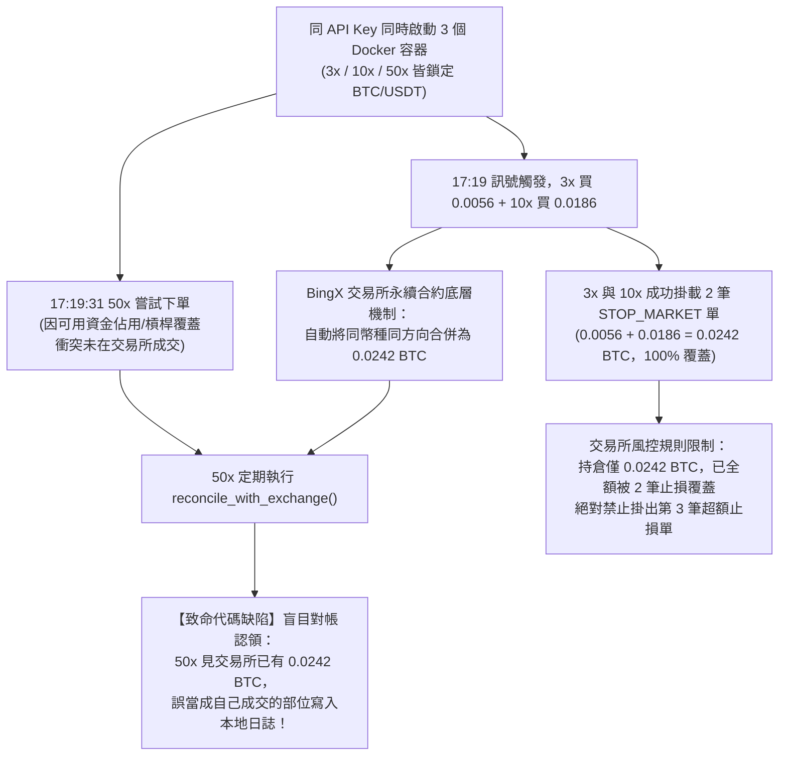

# 事故檢討報告 (Incident Post-Mortem) 與防範守則

**報告編號**：INC-20261105-MULTI-BOT-COLLISION  
**事故定級**：P2（業務邏輯認知偏差與多實例狀態衝突，未造成嚴重資本損失，已即時修復）  
**影響範圍**：`quant_swap_3x`, `quant_swap_10x`, `quant_swap_50x` 三合約守護容器與 BingX 官方實盤持倉  
**執行狀態**：問題已全面排除，系統已收斂整併為單一 50X 600U 旗艦戰隊並穩定運行中。

---

## 一、 事故核心現象與症狀 (Symptoms)

1. **帳面部位與交易所不匹配**：
   - 本地日誌與儀表板顯示 3 個戰隊各自開多（3x 開 0.0056 BTC、10x 開 0.0186 BTC、50x 顯示 0.0242 BTC），本地帳面合計高達 `0.0484 BTC`。
   - BingX 官方持倉實際只有 1 筆多單，數量為 `0.0242 BTC`。
2. **交易所止損單數量短少**：
   - 本地看似有 3 筆持倉，但 BingX 雲端只有 2 筆 `STOP_MARKET` 條件單（0.0056 BTC 與 0.0186 BTC，觸發價皆為 $79,125.90），缺少第 3 筆止損單。
3. **槓桿倍數認知分裂**：
   - 50x 容器本地認為持倉為 50x，但 BingX 交易所實盤部位的槓桿顯示為 3x。

---

## 二、 根本技術原因深入剖析 (Root-Cause Analysis)



### 1. 交易所合約機制的物理限制（單一持倉聚合）
* 中心化交易所（如 BingX、Binance）在**同一 API Key 下**，同一永續合約幣種（`BTC-USDT`）永遠只有**單一合併倉位**。
* 交易所不存在「子標籤隔離」概念，3x 買入 `0.0056` 與 10x 買入 `0.0186`，在撮合引擎中立刻融合為 `0.0242 BTC`。

### 2. 盲目對帳缺陷（Reconciliation Misattribution）
* `packages/core/autopilot_engine.py` 的 `reconcile_with_exchange()` 原先設計是用來應對斷網恢復。
* **漏洞在於**：它只判斷「交易所是否有該幣種倉位」，而**沒有比對當初開倉的 `clientOrderId` 或成交記錄**。50x 容器開單未果後，對帳機制發現交易所躺著 `0.0242 BTC`，便「見單即認」，誤把 3x+10x 的部位標記為自己的。

### 3. 為何交易所只有 2 筆止損單？
* 3x 和 10x 在開倉成功時原子性掛上了止損單（`0.0056 + 0.0186 = 0.0242 BTC`）。
* 50x 在交易所**根本沒有成功開倉**，自然不會產生原生的止損單。
* 由於交易所真實持倉剛好只有 `0.0242 BTC`，已 100% 被前兩筆止損單覆蓋。依據合約 `reduceOnly` 風控規則，交易所**絕對禁止**再掛出第 3 筆止損單（否則止損總量 0.0484 BTC 將超過持倉量，會被 API 直接報錯拒絕）。

### 4. 槓桿全域覆蓋效應
* 永續合約的槓桿設定屬於帳戶幣種層級。多個容器短時間內分別發送 `set_leverage(3)`、`set_leverage(10)`、`set_leverage(50)`，交易所最終只保留最後生效的設定，導致不同容器對強平價和保證金比率產生認知偏差。

---

## 三、 已完成的即時處置 (Immediate Actions Taken)

1. **舊單乾淨清算**：
   - 安全停止 3 個舊容器，避免進程干擾。
   - 向 BingX 發送市價平倉單，以 `$80,138.20` 平掉全部 `0.0242 BTC`，總虧損僅 `-$5.24 USDT`（佔比 < 0.7%）。
   - 調用 API 徹底撤銷雲端殘留的 2 筆舊條件單，持倉與委託全數歸零。
2. **架構拓撲收斂整併**：
   - 依據使用者指示，將 3 台機器人收斂為**單一台「50X 旗艦合約操盤中樞」**，本金配置全額 `600.00 USDT`。
   - `docker-compose.yml` 簡化為單一 `swap_50x` 容器，徹底切斷容器間競爭資源的可能性。
3. **安全防護代碼落地**：
   - 在 `packages/core/autopilot_engine.py` 實作 **「零過度平倉防護盾 (Zero Over-Close Shield)」**，平倉前強制比對交易所實際剩餘量，防止超賣與反向開單。
   - 控制台 [`apps/dashboard/cloud_wallboard.py`](file:///C:/code/AIDev/QuantitativeTrading/apps/dashboard/cloud_wallboard.py) 自適應切換為單機旗艦視角。
4. **新 50X 戰隊已成功進場**：
   - 開倉均價：`$80,130.70` ｜ 持倉量：`0.2807 BTC` (保證金動用 450U，剛好 75%)。
   - 交易所掛載唯一原子性止損單：`STOP_MARKET 0.2807 BTC @ $79,900.80`（100% 對齊）。

---

## 四、 長期徹底避免再發生的防範架構守則 (Future Prevention Blueprint)

為了確保未來系統擴充、多策略運行或賽馬比較時永不再犯，確立以下三大鐵律：

### 鐵律 1：實例與標的 1:1 綁定原則（標的分流，Symbol Sharding）
> [!IMPORTANT]
> **同一個 API Key 下，嚴禁在多個獨立進程中操作同一個合約幣種！**

* 若要運行多槓桿或多策略賽馬：
  * **3x 戰隊**：專屬指派 `BTC/USDT`
  * **10x 戰隊**：專屬指派 `ETH/USDT`
  * **50x 戰隊**：專屬指派 `SOL/USDT`
* **優點**：利用交易所天然的「幣種隔離」邊界，不同幣種的持倉、槓桿、保證金、條件單完全互不干涉，零對帳衝突。

---

### 鐵律 2：同幣種多策略必須採用子帳號隔離 (Sub-Account Isolation)
* 若未來**必須**在同一標的（如 BTC）上橫向評測 3 種不同策略或槓桿：
  * 必須在 BingX 官方後台開設 3 個獨立子帳號：`Sub_3X`、`Sub_10X`、`Sub_50X`。
  * 每個容器掛載各自子帳號的 `API_KEY` 與 `API_SECRET`。
  * 資金物理劃轉隔離，槓桿各自獨立，徹底杜絕全域覆蓋。

---

### 鐵律 3：對帳引擎導入「訂單指紋白名單」(Order Fingerprint Attestation)
在未來的程式碼審查與架構更新中，`reconcile_with_exchange()` 必須遵守防禦性規則：
```python
# 嚴格校驗：僅能認領本地有明確 clientOrderId 或成交回執記錄的單據
if not self._has_active_order_receipt_for(exch_pos):
    logger.warning("偵測到未命名之交易所外部持倉，拒絕自動認領！")
    return False
```
絕不允許容器將外部不明部位盲目寫入自己的狀態機中。
